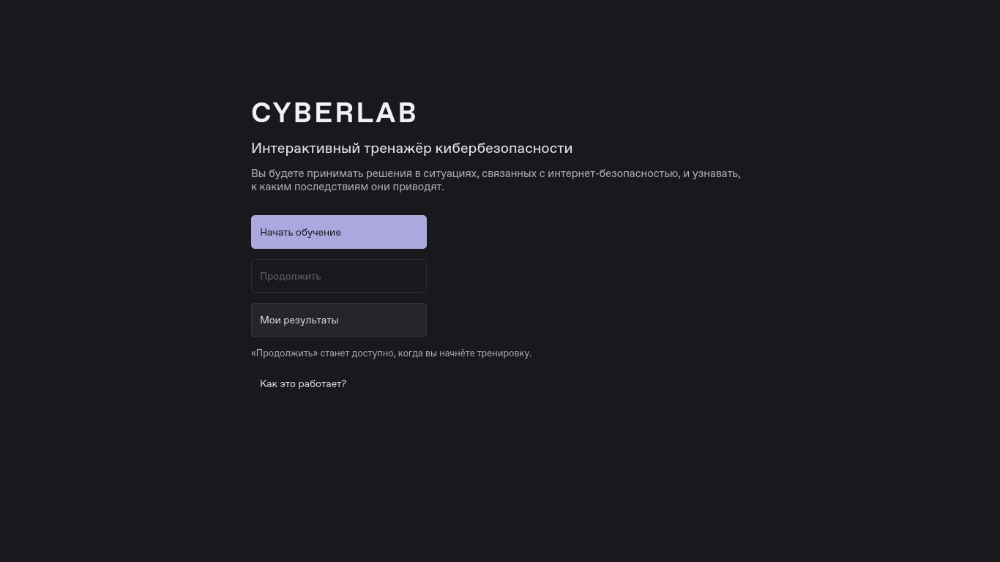

# CyberLab

CyberLab — учебный тренажёр кибербезопасности. Вы читаете ситуацию, выбираете
действие и видите, что произошло. Можно вернуться к прошлому решению,
попробовать другой вариант и сравнить результаты. Прежний путь останется в истории.

В программе четыре темы: подозрительное письмо, вредоносное вложение,
поддельный сайт и чужой USB-накопитель. Все действия происходят в учебной модели:
настоящие файлы и устройства программа не меняет.



## Установка

Python и редактор кода для готовой программы не нужны.
Архивы скачиваются с GitHub после входа в аккаунт.

### Windows

1. [Скачайте архив для Windows](https://github.com/kiollaif/cyberlab/actions/runs/41104157926/artifacts/13000842196).
2. Распакуйте его и откройте `CyberLab-Setup.exe`.
3. Завершите установку. Запускайте CyberLab через ярлык на рабочем столе
   или в меню «Пуск».

В архиве также есть `CyberLab.exe`: его можно открыть без установки.
При запуске консоль не появляется.

### Linux

1. [Скачайте архив для Linux x86_64](https://github.com/kiollaif/cyberlab/actions/runs/41104157926/artifacts/12999734140).
2. Распакуйте его и перенесите `CyberLab-x86_64.AppImage` в папку,
   где собираетесь хранить программу.
3. В свойствах файла разрешите запуск как программы, затем откройте его
   двойным нажатием. После первого запуска CyberLab появится в меню приложений.

Совместимость с Альт Образование пока не подтверждена.
Требования к системе и подробности установки — в [инструкции по сборкам](docs/desktop.md).

Эти файлы собраны из версии `9514a4a`.
[Сборка и автоматические проверки](https://github.com/kiollaif/cyberlab/actions/runs/41104157926)
завершились успешно. GitHub хранит архивы ограниченное время. Если ссылка устарела,
откройте [Desktop builds](https://github.com/kiollaif/cyberlab/actions/workflows/desktop.yml),
выберите успешную сборку ветки `build/guided-learning-ux` и найдите внизу раздел **Artifacts**.

## Первая тренировка

1. На главной нажмите **«Начать обучение»**.
2. Выберите тему, например письмо от «службы поддержки», и нажмите **«Начать тренировку»**.
3. Прочитайте ситуацию и выберите действие. После выбора появится объяснение
   последствий и изменение риска.
4. Нажмите **«Следующая ситуация»**, чтобы продолжить. После последнего выбора
   кнопка **«Посмотреть результат»** откроет итог.

Риск от 0 до 100 — учебная оценка опасности внутри сценария.
Это не проверка безопасности вашего настоящего компьютера.

Если нужно сначала разобраться с кнопками, откройте **«Как это работает?»**
на главной. Подсказки можно пропустить и открыть снова в любое время.

## Как попробовать другой вариант

В итогах нажмите **«Изменить решение»**. Выберите прошлый шаг и откройте его,
затем поступите иначе. Программа сохранит оба пути. Кнопка **«Сравнить результаты»**
покажет, где решения разошлись и как изменились последствия.

Во время тренировки возврат доступен через **«Инструменты» → «Ваши решения»**.
Там же находятся сравнение и учебный компьютер с почтой, файлами, браузером и журналом.
В итогах можно раскрыть разбор решений или сохранить текстовый отчёт кнопкой
**«Сохранить отчёт TXT»**.

## Как продолжить после закрытия

История сохраняется автоматически. При следующем запуске нажмите **«Продолжить»** —
откроется сохранённый шаг. Все начатые тренировки с принятыми решениями доступны
в разделе **«Мои результаты»**. Кнопка **«Заново»** начинает новую тренировку,
не удаляя предыдущие.

История хранится отдельно от программы:

- Windows: `%LOCALAPPDATA%\CYBERLAB\CYBERLAB\cyberlab.sqlite3`.
- Linux: `~/.local/share/CYBERLAB/CYBERLAB/cyberlab.sqlite3`
  или в каталоге, заданном через `XDG_DATA_HOME`.

## Наставник

В разделе **«Наставник»** можно попросить объяснить выбор или разобрать ошибки.
Обычные подсказки работают без интернета. Для онлайн-ответов можно подключить
DeepSeek; без ключа или при ошибке подключения останутся локальные объяснения.
Как подключить сервис, описано в [отдельной инструкции](docs/ai_integration.md).
Настоящие пароли и личные данные в вопросы вводить не нужно.

## Запуск из исходников

Этот раздел нужен, если вы хотите изучать или менять код.
Установите Python 3.12, Git и [uv](https://docs.astral.sh/uv/getting-started/installation/).
Для версии с описанным выше интерфейсом выполните в PowerShell или терминале:

```sh
git clone --branch build/guided-learning-ux https://github.com/kiollaif/cyberlab.git
cd cyberlab
uv sync --locked
uv run --locked cyberlab
```

Первый запуск требует интернета для установки зависимостей.
После установки сценарии, история, сравнение и локальный наставник работают офлайн.
Если в Linux не запускается окно, проверьте системные библиотеки Qt:
список есть в [инструкции по сборкам](docs/desktop.md).

Приложение написано на Python 3.12 с PySide6 и SQLite.
Для проверки изменений:

```sh
uv run --locked pytest
uv run --locked ruff check .
uv run --locked ruff format --check .
```

Объяснение исходников — в [STUDY_GUIDE.md](STUDY_GUIDE.md).
Планы разработки — в [DEVELOPMENT.md](DEVELOPMENT.md),
устройство программы — в [описании архитектуры](docs/architecture.md).
