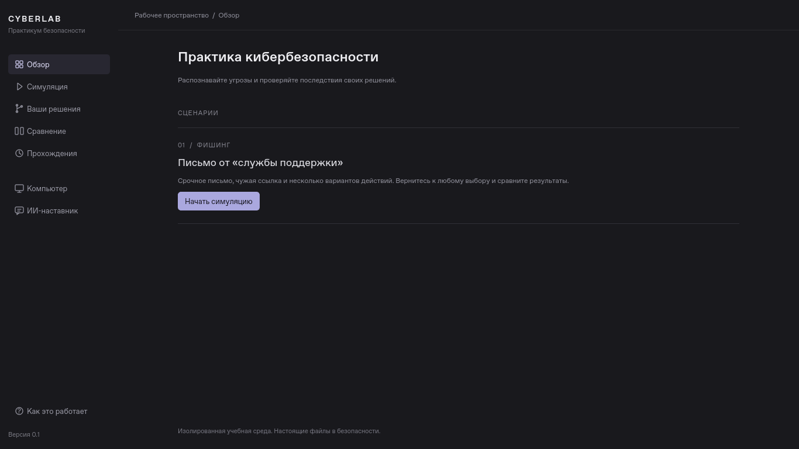

# CYBERLAB

Учебное настольное приложение на **Python 3.12, PySide6 и SQLite**.
Основная платформа будущей версии 1.0 — **Windows 10/11**, совместимость с Linux сохраняется.
Первый сценарий — фишинговое письмо от «службы поддержки».

Главная возможность: вернуться к любому решению, сделать другой выбор и сравнить
последствия. Старые ветки остаются в истории, в том числе после перезапуска.



[Симуляция](docs/simulation.png) · [Сравнение](docs/comparison.png) · [ИИ-наставник](docs/mentor.png)

В боковой панели находятся симуляция, решения, сравнение, сохранённые прохождения,
компьютер и наставник. На основном экране остаётся текущая задача.
Описание нового интерфейса и его проверок — [docs/interface.md](docs/interface.md).

Для изучения исходников начни со [STUDY_GUIDE.md](STUDY_GUIDE.md): там есть порядок
чтения, разбор пяти функций, упражнения и десять вопросов для защиты.
Реализованные возможности и план развития описаны в [DEVELOPMENT.md](DEVELOPMENT.md).
Проверка полноты и исправлений CI описана в [отчёте об аудите](docs/PROJECT_AUDIT.md).

## Установка без Python и терминала

Готовые приложения публикуются в **Artifacts** успешных запусков
[Desktop builds](https://github.com/kiollaif/cyberlab/actions/workflows/desktop.yml).
Результат конкретной сборки и ограничения — в [docs/desktop.md](docs/desktop.md).

- **Windows x86_64:** артефакт `CyberLab-Windows-x86_64`. Распакуйте архив,
  откройте `CyberLab-Setup.exe`. Установщик создаёт ярлыки на рабочем столе
  и в «Пуск». Отдельный `CyberLab.exe` запускается без установки и консоли.
- **Linux x86_64:** артефакт `CyberLab-Linux-x86_64`. Распакуйте архив,
  разрешите выполнение `CyberLab-x86_64.AppImage` в свойствах файла и откройте
  двойным нажатием. После первого запуска программа появляется в меню.
- **Альт Образование:** совместимость пока не подтверждена. RPM-кандидат для
  ALT p11 проверяется отдельно и не объявляется готовым выпуском для этой ОС.

Ни Python, ни uv, ни редактор кода пользователю сборки не нужны. Основной
сценарий и локальный наставник работают офлайн; история сохраняется вне папки
установки и остаётся после удаления программы.

## Запуск из исходников для разработки

Нужны Python 3.12 и [uv](https://docs.astral.sh/uv/getting-started/installation/).
Из корня репозитория, одинаково в PowerShell и Bash:

```sh
uv sync --locked
uv run --locked cyberlab
```

Альтернативная точка входа: `uv run --locked python -m cyberlab`.
`uv.lock` фиксирует зависимости; `.python-version` задаёт ветку Python 3.12.

На минимальной Ubuntu/Debian для графического режима могут потребоваться библиотеки Qt:

```sh
sudo apt-get install libegl1 libgl1 libopengl0 libfontconfig1 libdbus-1-3 \
  libxcb-cursor0 libxcb-icccm4 libxcb-image0 libxcb-keysyms1 libxcb-render-util0 \
  libxcb-shape0 libxcb-xinerama0 libxcb-xkb1 libxkbcommon-x11-0
```

Программа использует системный дисплей. Для автоматических тестов без дисплея
выбирается Qt `offscreen`; это не интерактивный удалённый рабочий стол.

## Первая тренировка

1. На экране «Обзор» нажмите **«Начать симуляцию»**. При первом старте появятся пять
   коротких шагов обучения с пробной кнопкой. Их можно пропустить, а затем повторить
   через «Как это работает». Пример обучения не записывает решения в историю.
2. Читайте ситуацию и выбирайте действие. После каждого выбора появится отдельный
   экран: что вы сделали, что произошло, почему и как изменился риск.
   **«Продолжить»** открывает следующую ситуацию или итог.
3. Для проверки опасного пути выберите «Открыть ссылку» → «Отправить учебный пароль» →
   «Продолжить работу», каждый раз читая последствие. В модели станут недоступны файлы.
4. В итогах нажмите **«Изменить решение»**. Раздел «Ваши решения» позволяет вернуться
   на один выбор кнопкой «На шаг назад», к любому выбранному шагу дерева
   или к началу сценария. Прежние ветки остаются.
5. Вернитесь к началу и выберите «Проверить письмо» → «Сообщить о фишинге».
   После завершения нажмите **«Сравнить результаты»** или откройте «Сравнение» слева: два результата показываются
   рядом, различия отмечены знаком ≠. Ниже — место расхождения и краткий вывод;
   полный разбор решений открывается по желанию.
6. Флажок «Показать промежуточные шаги» позволяет сравнить любые снимки.
   Сравнение доступно и до итога — из боковой панели. Оно не перемещает текущий шаг.
7. «Заново» создаёт новую тренировку, сохраняя предыдущие. Сохранения доступны
   в разделе **«Прохождения»** слева; на обзоре есть **«Продолжить прохождение»**. После перезапуска
   восстанавливаются выбранная тренировка, её шаг и даже непрочитанное последствие.

На виртуальном ПК есть почта, просмотр содержимого файлов, журнал, макет браузера
и вкладка «Наставник». Компьютер открывается из боковой панели: вкладки объясняют
своё назначение, изменившиеся отмечены точкой и цветом. Последствия видны и без вкладок.
Локальный наставник объясняет текущий снимок по правилам. Отдельная панель
**«ИИ-наставник»** подключает DeepSeek по запросу и автоматически возвращается
к локальным объяснениям при отсутствии ключа или ошибке. Будущие узлы сценария
модели не передаются.
Четыре возможных итога: раннее сообщение о фишинге, остановка до отправки пароля,
изоляция после утечки и потеря доступа к учебным файлам.

Риск 0–100 — условная учебная шкала. Сеть, письма, пароли и шифрование моделируются
в памяти. Приложение не отправляет письма, не обращается по ссылкам и не меняет
настоящие файлы. Настоящий пароль не запрашивается.

## Данные

SQLite хранится в пользовательском каталоге, который определяет Qt
`QStandardPaths.AppLocalDataLocation`: обычно `%LOCALAPPDATA%/CYBERLAB/CYBERLAB`
на Windows и `~/.local/share/CYBERLAB/CYBERLAB` на Linux. Путь может зависеть
от системных настроек (`XDG_DATA_HOME` и др.).

Для отдельной тренировки можно указать другую базу. Родительский каталог создаётся автоматически:

```sh
uv run --locked cyberlab --database ./practice.sqlite3
```

Решение и активный указатель сохраняются одной транзакцией. Повтор того же решения
из того же снимка открывает существующую ветку без дублирования. «К началу сценария»
перемещает указатель, не удаляя данные. SQLite и виртуальное окружение исключены из Git.

Старые базы **SQLite v1** открываются без изменения схемы. `QSettings` отдельно
хранит факт прохождения обучения, id последней открытой тренировки и непрочитанного
последствия. На Windows это пользовательские настройки Qt в реестре, на Linux —
обычно `~/.config/CYBERLAB/CYBERLAB.conf`. Потеря этих настроек не удалит историю SQLite.

Окна поддерживают вертикальную прокрутку, перенос русских текстов и масштаб Qt.
В Linux проверены размеры 1280×720 и 1366×768, а также уменьшенные логические размеры
и масштабы 125/150%. Windows 10/11 и ALT Образование требуют отдельных проверок на этих ОС.
Для запуска из исходников на ALT нужны Python 3.12 и системные графические
библиотеки Qt; команды Ubuntu не следует автоматически переносить на ALT.
Собранные приложения включают Python и Qt; их системные требования отличаются.

## DeepSeek AI — необязательное подключение

После `uv sync --locked` задайте ключ в той же консоли, из которой запускаете приложение.
В PowerShell:

```powershell
$env:DEEPSEEK_API_KEY = "ваш_ключ_DeepSeek"
uv run --locked cyberlab
```

В Bash можно ввести ключ без отображения:

```bash
read -rsp "DeepSeek API key: " DEEPSEEK_API_KEY
export DEEPSEEK_API_KEY
uv run --locked cyberlab
```

Откройте «ИИ-наставник»: задайте вопрос, запросите объяснение решения или разбор
ошибок. Для анализа двух путей откройте сравнение, выберите варианты и перейдите
оттуда к ИИ. Запросов при переключении страниц нет; работа идёт в фоновом потоке Qt.
Используются `https://api.deepseek.com`, только `deepseek-flash`, отключённый thinking,
лимит 350 токенов ответа, тайм-аут операций SDK 12 секунд и отсутствие автоповторов.

Не вводите в вопрос настоящие пароли и личные данные. Ключ не хранится в SQLite
или исходниках. Без ключа и без интернета приложение работает с локальным наставником.
Режим подписан честно: «DeepSeek AI — онлайн» после успешного ответа либо
«Локальный наставник — офлайн». При наличии статистики показаны потраченные токены.

Живой API в облаке не проверялся: ключ не предоставлен. Тесты имитируют HTTP-ответы
в настоящем SDK и не тратят деньги. Доступность модели для аккаунта и качество
её ответов требуют отдельной проверки. Устройство, ограничения и примеры для
защиты — в [docs/ai_integration.md](docs/ai_integration.md).

## Архитектура

```text
src/cyberlab/
  domain.py      Неизменяемое состояние ПК, переходы, сравнение снимков
  scenarios.py   Текст и граф первого сценария
  storage.py     Дерево решений и транзакции SQLite, версия схемы
  session.py     Выбор решения, переход к снимку, восстановление сессии
  mentor.py      Локальные объяснения состояния, сделанного выбора и сравнения
  ai_context.py  Ограниченная копия уже известных учебных данных
  ai_client.py   DeepSeek API через OpenAI SDK и возврат к локальным правилам
  ai_panel.py    Панель наставника и фоновый поток Qt
  learning.py    Путь снимка, прогресс и учебный разбор решений
  ui.py          Обзор, переключение экранов, открытие сохранённых тренировок
  navigation.py  Боковая панель и значки, нарисованные средствами Qt
  simulation_pages.py  Ситуация, последствие, экран итогов
  review_pages.py      Ваши решения и сравнение двух вариантов
  tutorial.py          Пять шагов интерактивного обучения
  virtual_computer.py  Экран виртуального компьютера
  ui_helpers.py  Общие элементы интерфейса
  styles.py      Цвета, шрифты и оформление Qt
  app.py         Точка входа и выбор пользовательского каталога данных
tests/           Модель, SQLite, UI, наставник и примеры учебного руководства
```

Модель не зависит от Qt и SQLite. Каждый узел истории хранит **полный снимок** и
`parent_id`. Возврат назад выбирает сохранённый снимок, а следующий выбор добавляет
ребёнка к нему. Состояние исходной ветки не вычисляется заново и не перезаписывается.
Подробнее о границах слоёв и расширении сценариев — [docs/architecture.md](docs/architecture.md).

## Проверки

```sh
uv run --locked pytest
uv run --locked ruff check .
uv run --locked ruff format --check .
uv build
uv run --locked python scripts/check_package.py
```

Тесты проходят все восемь маршрутов сценария и проверяют ветвление, повтор выбора,
восстановление после перезапуска, изоляцию сессий и сравнение. GUI-тесты нажимают
кнопки Qt, проходят обучение, возвращаются через дерево и проверяют виртуальные файлы.
Есть проверки старой SQLite из предыдущего коммита, ошибки сохранения, истории разных
тренировок, маленьких окон и масштаба Qt в отдельных процессах.
Отдельный smoke test запускает точку входа с настоящим циклом событий Qt.
Python-примеры из `STUDY_GUIDE.md` также выполняются тестами, каждый отдельно.

GitHub Actions настроен на Python 3.12 для **Windows и Ubuntu**. На Ubuntu
GUI-тесты работают через X11/Xvfb, на Windows — через системный Qt-плагин.
Точный размер 1366×768 отдельно проверяется в `offscreen`: нативное окно Windows
учитывает рамку и доступный рабочий стол. Существующие проверки прохождения сохранены.
Workflow запускается и для отдельных веток. Перед тестами проверяются зависимости
Qt; после сборки wheel устанавливается в отдельный venv из кэша без сети.
JUnit и пакеты сохраняются в артефакты, причины падений — в аннотации.

Для запуска `check_package.py` без дисплея нужно задать `QT_QPA_PLATFORM=offscreen`.
Офлайн-проверка запрещает сетевые операции Python; её границы и фактические результаты
Windows/Linux приведены в отчёте об аудите. Первичная установка зависимостей требует
сети или заранее заполненного кэша.

Это рабочий прототип: один сценарий, необязательный DeepSeek API, без установщика.
Проверенная здесь конфигурация и результаты описаны в [docs/validation.md](docs/validation.md).
