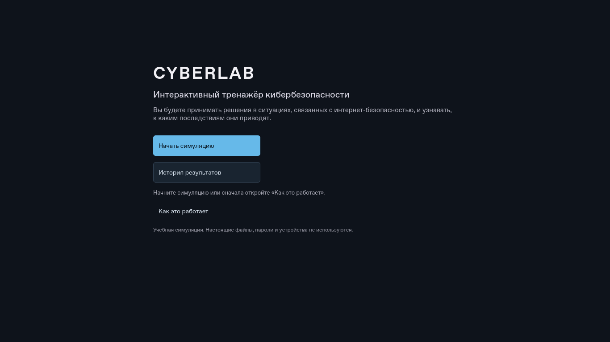

# CYBERLAB 2.0

CyberLab — настольный тренажёр кибербезопасности для школьников. Вы читаете ситуацию,
выбираете действие и разбираете последствия. Можно вернуться к прошлому решению,
попробовать иначе и сравнить оба результата. История сохраняется после закрытия.

Это учебная модель: программа не заражает компьютер, не запускает опасные файлы
и не отправляет сообщения. Настоящие пароли в ней не нужны.



Сейчас готовится версия **2.0.0b1**. Её исходники находятся в ветке
[`build/cyberlab-2`](https://github.com/kiollaif/cyberlab/tree/build/cyberlab-2).

## Скачать и запустить

Готовые программы собираются в
[GitHub Actions → Desktop builds](https://github.com/kiollaif/cyberlab/actions/workflows/desktop.yml).
Выберите успешную сборку ветки `build/cyberlab-2`. Внизу страницы, в разделе
**Artifacts**, находятся архивы. Для скачивания нужен вход в GitHub.

Проверенная версия **2.0.0b1**, код `3b3af9b`:

| Система | Скачать ZIP |
| --- | --- |
| Windows x86_64 | [Установщик и приложение](https://github.com/kiollaif/cyberlab/actions/runs/42506205331/artifacts/13627642548) |
| Linux x86_64 | [AppImage](https://github.com/kiollaif/cyberlab/actions/runs/42506205331/artifacts/13627293614) |

Архивы хранятся 90 дней. [Результаты этой сборки](https://github.com/kiollaif/cyberlab/actions/runs/42506205331).

- **Windows x86_64:** скачайте `CyberLab-Windows-x86_64`, распакуйте ZIP
  и откройте `CyberLab-Setup.exe`. После установки запускайте программу ярлыком
  на рабочем столе или в «Пуск». Отдельный `CyberLab.exe` работает без установки.
- **Linux x86_64:** скачайте `CyberLab-Linux-x86_64` и распакуйте ZIP.
  В свойствах `CyberLab-x86_64.AppImage` разрешите выполнение как программы,
  затем откройте файл двойным нажатием. После первого запуска появится пункт в меню.

Для готовой сборки не нужны Python, терминал и редактор кода.
Требования к Linux и сведения о проверках — в [инструкции по сборкам](docs/desktop.md).
Совместимость с **Альт Образование** пока нельзя считать подтверждённой:
проверка контейнера ALT p11 не заменяет запуск на школьной системе.

## Первая тренировка

1. Нажмите **«Начать симуляцию»** и выберите тему.
2. Посмотрите её сложность и учебные цели. Перед первым запуском можно пройти
   короткий вводный урок или сразу нажать **«Начать тренировку»**.
3. Прочитайте вымышленное сообщение или описание файла. Выберите действие.
4. Разберите последствие: что произошло, почему изменился риск и что означает схема.
   Узлы схемы можно нажимать для пояснения.
5. Нажмите **«Следующая ситуация»**. После последнего решения откройте результат.

В программе шесть тем:

| Тема | Что разбираем |
| --- | --- |
| Подозрительное письмо | Отправитель, срочность и передача пароля |
| Неожиданное вложение | Проверка документа и разрешение макросов |
| Поддельный сайт | Точный адрес, форма входа и отзыв чужих сеансов |
| Чужой USB-накопитель | Подключение устройства и запуск программы |
| Сообщение со ссылкой | Проверка знакомого профиля и распространение обмана |
| Загрузка программы | Источник установщика и просьба отключить защиту |

## Риск и оценка

Риск — условная опасность ситуации внутри сценария: **0–25 — низкий**,
**26–50 — умеренный**, **51–75 — высокий**, **76–100 — критический**.
Это не вероятность атаки и не проверка настоящего компьютера.

Оценка решений показывает качество выбранного пути: полезное действие даёт 2 балла,
нейтральное — 1, рискованное — 0. Сумма переводится в шкалу 0–100.
**Оценка выше — лучше; риск ниже — безопаснее.** Позднее исправление может уменьшить
риск, но прежняя ошибка остаётся в разборе.

В итогах есть график риска, число безопасных и рискованных действий, рекомендации
и подробный разбор. Точку графика можно нажать, чтобы посмотреть соответствующее решение.
Отчёт сохраняется в **PDF** или **TXT**.

## Вернуться, повторить и сравнить

**«Изменить решение»** в итогах открывает прошлые шаги. Выберите шаг и попробуйте
другой вариант: прежний путь останется в истории. Затем нажмите **«Сравнить результаты»**.
Во время тренировки возврат и учебный компьютер доступны через **«Инструменты»**.

**«Заново»** создаёт новую тренировку. **«Продолжить»** на главной возвращает
сохранённый шаг. **«История результатов»** показывает завершённые варианты и
текущие прохождения всех тем. Там есть фильтр и диаграмма оценок по времени.

Данные хранятся отдельно от программы:

- Windows: `%LOCALAPPDATA%\CYBERLAB\CYBERLAB\cyberlab.sqlite3`.
- Linux: `~/.local/share/CYBERLAB/CYBERLAB/cyberlab.sqlite3` или каталог из `XDG_DATA_HOME`.

Старые истории SQLite v1 открываются без удаления записей.

## Помощник CyberLab

Основной помощник — **система на правилах**, не нейросеть. Он объясняет сохранённые
решения и содержит локальную справку: фишинг, HTTPS, макросы, USB, пароли и другие
термины. Если точного ответа нет, он сообщает об этом. Интернет и оплата не нужны.

Прежнее необязательное подключение DeepSeek и совместимого API сохранено для
экспериментов. Оно не влияет на риск и историю. Настройка и ограничения описаны
в [инструкции помощника](docs/ai_integration.md). Не вводите личные данные и реальные пароли.

## Запуск из исходников

Для работы с кодом нужны Python 3.12, Git и [uv](https://docs.astral.sh/uv/getting-started/installation/).

```sh
git clone --branch build/cyberlab-2 https://github.com/kiollaif/cyberlab.git
cd cyberlab
uv sync --locked
uv run --locked cyberlab
```

После установки зависимостей тренировки работают без сети.

```sh
uv run --locked pytest
uv run --locked ruff check .
uv run --locked ruff format --check .
uv build
```

Устройство исходников — в [STUDY_GUIDE.md](STUDY_GUIDE.md), планы — в
[DEVELOPMENT.md](DEVELOPMENT.md). Изменения 2.0, проверка пользовательского пути,
снимки экранов и реальные результаты тестов собраны в [отчёте](docs/cyberlab2.md).
