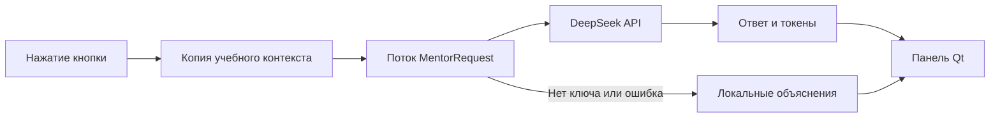

# Как устроен ИИ-наставник CYBERLAB

## Кто принимает решения

Последствия рассчитывает прежний `Scenario.advance` из `domain.py`, затем
`LabSession.choose` сохраняет снимок в SQLite. DeepSeek подключён только для объяснений:
он не определяет риск, не выбирает действия за ученика и не пишет в историю.
При выключенном интернете сценарий и сравнение продолжают работать.

В обычной вкладке «Наставник» виртуального компьютера остаются локальные правила.
Отдельная панель «ИИ-наставник» доступна из меню, ситуации, последствия, итогов
и сравнения. Нажатие этой кнопки **не отправляет запрос**.

## Что делает панель

- «Спросить ИИ» отвечает на вопрос по кибербезопасности.
- «Объяснить моё решение» разбирает последнее уже принятое действие.
- «Проанализировать ошибки» разбирает текущий путь и предлагает безопасные привычки.
- «Сравнить выбранные варианты» объясняет различия двух сохранённых путей. Для этого
  сначала откройте сравнение, выберите варианты и перейдите оттуда в ИИ-наставника.

После успешного ответа показан режим **«DeepSeek AI — онлайн»**. При отсутствии ключа
или ошибке — **«Локальный наставник — офлайн»** и объяснение по старым правилам.
До первого успешного запроса программа не утверждает, что связь с DeepSeek установлена.
Свободный разговор локальные правила не поддерживают: вместо выдуманного ответа
они объясняют текущую учебную ситуацию.

## Четыре новых файла

| Файл | Простое объяснение |
| --- | --- |
| `ai_context.py` | Собирает короткую записку о текущей ситуации и уже пройденном пути |
| `ai_client.py` | Отправляет эту записку в официальный API и переводит ошибки в понятные сообщения |
| `ai_panel.py` | Показывает вопрос, кнопки, ожидание, ответ и статистику; запускает фоновый поток |
| `docs/ai_integration.md` | Эта инструкция для изучения и защиты проекта |

В `ui.py` добавлены кнопки открытия панели и обновление её контекста. Старые
`mentor.py`, `domain.py`, `session.py` и схема SQLite не заменены ИИ.

## Как проходит один запрос



1. `build_context` собирает сведения в основном потоке Qt. Он идёт по `parent_id`
   только к предкам выбранного снимка. Другие ветки сами по себе не отправляются.
2. `AiMentorPanel.ask` проверяет, что нет другого незавершённого запроса.
3. `MentorRequest.run` вызывает `DeepSeekClient.answer` в отдельном `QThread`.
   Пока сервер отвечает, основной цикл Qt обрабатывает нажатия и перерисовку.
4. Сигнал `reply_ready` доставляет результат в основной поток. Виджеты меняются
   только там. У фонового потока нет ссылки на `LabSession` или соединение SQLite.
5. Если ученик вернулся к другому шагу или сменил сравнение, ключ контекста уже
   другой: ответ к старой ситуации не показывается. Полученная статистика токенов
   при этом учитывается, потому что сервер уже обработал запрос.

При закрытии окна во время запроса ответ перестаёт отображаться. Окно закрывается
после завершения потока; ожидание не блокирует цикл Qt. Нельзя уничтожать работающий
`QThread`: это могло бы аварийно завершить приложение.

## Какие данные отправляются

- Название и описание **текущей** ситуации.
- Уже совершённые действия, их последствия и риск до/после.
- Учебное состояние пароля, файлов, сети, почты и браузера.
- Вопрос, если нажата кнопка «Спросить ИИ».
- Два выбранных сохранённых пути, только когда открыто сравнение.

Не отправляются содержимое настоящих или виртуальных файлов, API-ключ в тексте
сообщений, идентификаторы SQLite, все узлы сценария и непройденные события.
Ключ используется SDK только для авторизации HTTPS-запроса.

Вопрос ограничен 1000 символами, учебный контекст — 8000. История переписки
не накапливается и не отправляется повторно: каждый запрос самостоятельный.
Перед отправкой скрываются типичные email, номера телефонов, ключи `sk-...`
и значения после `пароль:`/`пароль=`. Такой фильтр не умеет надёжно распознавать все
имена и личные сведения. **Не вводите реальные пароли и личные данные в вопрос.**

Системная инструкция требует русского языка, простых объяснений для 6–11 классов
и запрещает раскрывать будущие события. Программа не передаёт будущие узлы,
но текст внешней модели нельзя гарантировать формальными тестами: она может
ошибаться, домысливать и давать неточные советы. Источник результатов — сама симуляция.

## Настройка DeepSeek

Установите зависимости из корня репозитория:

```sh
uv sync --locked
```

В PowerShell:

```powershell
$env:DEEPSEEK_API_KEY = "ваш_ключ_DeepSeek"
uv run --locked cyberlab
```

В Bash на Linux ключ можно ввести без отображения:

```bash
read -rsp "DeepSeek API key: " DEEPSEEK_API_KEY
export DEEPSEEK_API_KEY
uv run --locked cyberlab
```

Переменная нужна в процессе, из которого запускается CYBERLAB. После изменения
ключа перезапустите приложение. Не добавляйте его в исходники или файлы Git.
`.env` исключён из Git, но приложение намеренно не загружает такой файл автоматически.
Без переменной запускается тот же CYBERLAB с локальным наставником.

## Параметры и стоимость

`ai_client.py` использует OpenAI Python SDK, но отправляет запрос в **DeepSeek**:

| Параметр | Значение |
| --- | --- |
| Base URL | `https://api.deepseek.com` |
| Модель | Только `deepseek-flash` |
| Thinking | `extra_body={"thinking": {"type": "disabled"}}` |
| Лимит ответа | `max_tokens=350` |
| Тайм-аут операций SDK | 12 секунд |
| Автоматические повторы | Отключены: `max_retries=0` |

Новый запрос выполняется только по кнопке. Пока он идёт, кнопки запроса выключены;
проверка `busy` защищает и от повторного сигнала. При ошибке программа сама не
посылает повторный платный запрос. Пользователь может повторить его вручную.

Если сервер вернул статистику, показаны входные, выходные и общие токены последнего
ответа и сумма полученных токенов за сеанс. Это не цена в рублях. Если статистики нет
или запрос оборвался, программа не утверждает, что списано ноль: учёт на стороне
DeepSeek может отличаться. Ответы ИИ и статистика не сохраняются в SQLite.

## Что происходит при ошибке

Нет ключа — SDK-клиент вообще не создаётся. Нет связи, тайм-аут, неверный ключ (401),
нехватка средств (402), запрет доступа (403), лимит (429), серверная ошибка или
непонятный ответ — показываются понятное сообщение и локальное объяснение.
Текст исключения SDK в интерфейс не выводится, чтобы не раскрыть служебные данные.
Модель не подменяется другой. Если `deepseek-flash` недоступна аккаунту, работает
локальный режим.

## Как проверяется интеграция

Тесты используют `httpx.MockTransport` внутри **настоящего OpenAI SDK**. Проверяются
адрес API, имя модели, non-thinking, лимит, статистика, отсутствие повторов,
успех, 401/402/403/429/500/404, отсутствие сети и тайм-аут. Денег они не тратят.
Другие тесты проверяют границы контекста, неизменность SQLite, отзывчивость Qt,
двойное нажатие, возврат к старому шагу во время запроса и безопасное закрытие окна.

Живой ответ DeepSeek не проверен: `DEEPSEEK_API_KEY` в облаке отсутствует. Доступность
именно `deepseek-flash` для реального аккаунта, качество её объяснений и фактическое
списание средств требуют отдельной проверки владельцем ключа. Автоматические тесты
проверяют реализацию запросов и обработку ответов, а не выдают имитацию за ответ сервера.

Для защиты проекта можно объяснить: «Сценарий определяет результат и сохраняет
снимок. ИИ получает ограниченную записку об уже произошедшем и объясняет её.
Если ИИ недоступен, учебный алгоритм продолжает работать самостоятельно».
