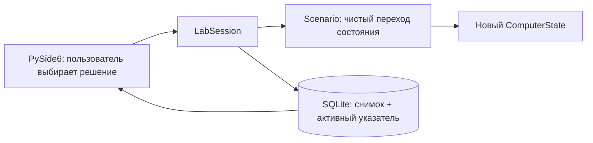

# Архитектура CYBERLAB

## Поток решения



`ComputerState` — замороженный dataclass. Он содержит учебный риск, состояние
учётных данных, файлов, сети, почты, браузера и журнал событий. Виртуальные файлы
объявлены в `domain.py`: их содержимое не читается с диска. Состояние
`files_encrypted=True` меняет только их отображение.

`Scenario` состоит из узлов с вариантами выбора. `StateChange` применяет только
перечисленные изменения и добавляет событие. Такой переход детерминирован:
одинаковые исходный снимок и решение дают одинаковый результат.

`LabSession` связывает модель и хранилище. Интерфейс не пишет SQL и не определяет
последствия решения. После успешного сохранения он перерисовывает состояние.

## Небольшие модули интерфейса и наставника

`ui.py` содержит главное окно: получение действий пользователя и обновление панелей.
Виртуальный ПК вынесен в `virtual_computer.py`, оформление — в `styles.py`, три общих
помощника для создания виджетов — в `ui_helpers.py`. Это разделение обычных файлов,
без фреймворка внедрения зависимостей или системы плагинов.

`mentor.py` не зависит от Qt или SQLite. `explain_state` читает текущий снимок,
а `explain_comparison` использует `compare_states` для выбранных A/B. Подсказки
пересоздаются после возврата к шагу и смены сравнения, сами снимки не меняются.
Сейчас это локальные правила, не AI-модель. Реальный AI-клиент планируется отдельно;
он не должен управлять переходами сценария или записью истории.

Для последовательного изучения исходников есть [STUDY_GUIDE.md](../STUDY_GUIDE.md).

## Почему история — дерево

```text
Получено письмо
├── Открыть ссылку
│   ├── Отправить учебный пароль
│   │   ├── Продолжить работу → файлы недоступны
│   │   └── Изолировать ПК → файлы доступны, пароль раскрыт
│   └── Закрыть и сообщить → пароль защищён
└── Проверить письмо
    └── Сообщить о фишинге → атака остановлена
```

У таблицы `sessions` есть `scenario_id` и `active_entry_id`. Таблица `entries`
хранит снимки, их `parent_id`, идентификаторы решений и тексты выбора. Полный
снимок сериализуется в JSON внутри SQLite; журнал хранится вместе с ним.
Внешние ключи запрещают ссылки между чужими сессиями. Уникальность
`(session_id, parent_id, choice_id)` не позволяет повторно создавать одну ветку.

При возврате меняется только активный указатель. Прежние снимки не удаляются.
При новом выборе запись ребёнка и изменение указателя выполняются в одной
транзакции. При ошибке сохранения интерфейс показывает сообщение, а активное
состояние в памяти не продвигается.

Сравнение читает два снимка, независимо от активного шага. Оно показывает риск,
состояние учётных данных, файлов, сети и письма. Различия выделяет интерфейс;
чистая функция `compare_states` определяет сравниваемые значения.

## Добавление сценариев

1. Создать `Scenario` с уникальным версионированным `id`, стартовым узлом и
   кортежем `ScenarioNode`.
2. Описать `Choice` и `StateChange`. Узел без вариантов — завершение.
3. Передать сценарий в `LabSession(repository, scenario=...)`.
   Заголовок окна сценария берётся из `scenario.title`. Выбор сценариев в UI
   пока не реализован; макеты письма и браузера остаются связанными с фишингом.
4. Добавить тесты путей, возврата и результатов. Ссылки между узлами должны
   существовать; текущий сценарий должен завершаться на любом маршруте.

При несовместимом изменении графа нужен **новый id сценария**: существующие
истории привязаны к прежним идентификаторам решений и снимкам. Сейчас поставляется
только `phishing-v1`. Формат БД имеет `PRAGMA user_version = 1`; более новая версия
отклоняется без перезаписи. Для будущих изменений схемы нужны явные миграции.

Изменение последствий, даже без смены графа, тоже требует нового id сценария:
повтор решения открывает сохранённую ветку с прежними значениями. Учебные правки
кода не меняют уже записанные снимки.

## Границы прототипа

Окно и SQLite работают в одном потоке: операции с маленькими локальными снимками
короткие. Для больших сценариев потребуются модель дерева Qt и фоновые операции.
Прототип рассчитан на один процесс на базу; совместное редактирование истории
несколькими процессами и редактор сценариев не реализованы.

Основная платформа запланированной версии 1.0 — Windows 10/11. Общие правила
симуляции и SQLite не зависят от платформы, Linux остаётся в CI. В учебном
рефакторинге формат v1, id сценария и последствия всех прежних решений сохранены.

Адреса `.invalid` и `.example` вымышлены. Приложение не запускает браузер ОС,
почтовый клиент, внешние команды и не устанавливает соединения. С диском работают
только SQLite и стандартное хранение данных приложения. Для реальных сетевых
лабораторий потребуется отдельная архитектура изоляции; этот прототип их не выполняет.
