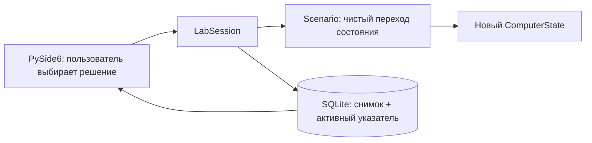

# Архитектура CYBERLAB

## Поток решения



`ComputerState` — замороженный dataclass. Он содержит учебный риск, состояние
учётных данных, файлов, сети, почты, браузера и журнал событий. Виртуальные файлы
объявлены в `domain.py`: их содержимое не читается с диска. Состояние
`files_encrypted=True` меняет только их отображение.

`Scenario` состоит из узлов с вариантами выбора. `StateChange` применяет только
перечисленные изменения и добавляет событие. Такой переход детерминирован:
одинаковые исходный снимок и решение дают одинаковый результат.

`LabSession` связывает модель и хранилище. Интерфейс не пишет SQL и не определяет
последствия решения. После успешного сохранения он перерисовывает состояние.

## Небольшие модули интерфейса и наставника

`ui.py` содержит обзор, навигацию через `QStackedWidget` и открытие старых
тренировок. `navigation.py` рисует компактную боковую панель и значки через Qt,
посылая имена выбранных разделов сигналом `navigate`. На узком окне остаются значки
с русскими подсказками и доступными именами. `simulation_pages.py` отвечает за ситуацию, последствие и итог;
`review_pages.py` — за дерево и сравнение, `tutorial.py` — за пять шагов обучения.
Виртуальный ПК находится в `virtual_computer.py`, оформление — в `styles.py`, общие
помощники для создания виджетов — в `ui_helpers.py`. Это разделение обычных файлов,
без фреймворка внедрения зависимостей или системы плагинов.

`mentor.py` не зависит от Qt или SQLite. `explain_state` читает текущий снимок,
`explain_decision` объясняет разницу до/после уже принятого решения,
а `explain_comparison` использует `compare_states` для выбранных A/B. Наставник
не перечисляет будущие события. Подсказки пересоздаются после возврата и сравнения,
сами снимки не меняются.
Это локальные правила. Дополнительно `ai_client.py` подключает DeepSeek API:
`ai_context.py` готовит ограниченную копию текущего пути, а `ai_panel.py` отправляет
её по кнопке в фоновом `QThread`. Результат поступает сигналом Qt. У потока нет
ссылки на `LabSession` или соединение SQLite. Старый ответ отбрасывается при смене
шага; запросы не запускаются автоматически при навигации. Ошибки API возвращают
пользователя к локальным правилам. Подробнее — [ai_integration.md](ai_integration.md).

`learning.py` готовит представление истории без её изменения: `history_path`
идёт по родителям и разворачивает путь, `decision_rating` оценивает конкретное
изменение, `remaining_decisions` считает наибольшее число оставшихся выборов в
графе без циклов. Прогресс не обещает одинаковую длину всех маршрутов.

После выбора `LabSession.choose` сразу сохраняет снимок. Окно сначала показывает
`ConsequencePage`, а по «Продолжить» — следующий `SituationPage` или `ResultsPage`.
Эта кнопка меняет только отображение. Все экраны имеют прокрутку; длинные надписи
в кнопках используют вложенный `QLabel` с переносом.

`QSettings` отдельно хранит `tutorial_completed`, `last_session` и `pending_feedback`.
Это предпочтения интерфейса, не новая схема SQLite. Если последнее сохранённое id
отсутствует в открытой базе или относится к другому сценарию, используется последняя
тренировка текущего сценария. Снимки не удаляются при сбросе предпочтений.
Пробный выбор в обучении не вызывает `choose` и не записывает ничего в историю.

Для последовательного изучения исходников есть [STUDY_GUIDE.md](../STUDY_GUIDE.md).

## Почему история — дерево

```text
Получено письмо
├── Открыть ссылку
│   ├── Отправить учебный пароль
│   │   ├── Продолжить работу → файлы недоступны
│   │   └── Изолировать ПК → файлы доступны, пароль раскрыт
│   └── Закрыть и сообщить → пароль защищён
└── Проверить письмо
    └── Сообщить о фишинге → атака остановлена
```

У таблицы `sessions` есть `scenario_id` и `active_entry_id`. Таблица `entries`
хранит снимки, их `parent_id`, идентификаторы решений и тексты выбора. Полный
снимок сериализуется в JSON внутри SQLite; журнал хранится вместе с ним.
Внешние ключи запрещают ссылки между чужими сессиями. Уникальность
`(session_id, parent_id, choice_id)` не позволяет повторно создавать одну ветку.

При возврате меняется только активный указатель. Прежние снимки не удаляются.
При новом выборе запись ребёнка и изменение указателя выполняются в одной
транзакции. При ошибке сохранения интерфейс показывает сообщение, а активное
состояние в памяти не продвигается.

Сравнение читает два снимка, независимо от активного шага. Оно показывает риск,
состояние учётных данных, файлов, сети и письма. Различия выделяет интерфейс;
чистая функция `compare_states` определяет сравниваемые значения.

Сравнивать можно ветки разных тренировок **одного сценария**. По умолчанию доступны
итоги; флажок добавляет промежуточные снимки. Если итогов ещё нет, показываются только
имеющиеся шаги. Тексты решений и причин берутся из пути каждого снимка; одинаковые
значения риска не считаются доказательством одинаковых путей. Просмотр дерева
сначала показывает описание; лишь кнопка возврата вызывает `go_to`.

`HistoryRepository.sessions` читает существующие сессии, `LabSession.open_session`
проверяет принадлежность сценарию и загружает её активный снимок. Эти методы не
меняют таблицы. Совместимость проверяется SQL-дампом из кода `685ba05`.

## Добавление сценариев

1. Создать `Scenario` с уникальным версионированным `id`, стартовым узлом и
   кортежем `ScenarioNode`.
2. Описать `Choice` и `StateChange`. Узел без вариантов — завершение.
3. Передать сценарий в `LabSession(repository, scenario=...)`.
   Добавить объект в SCENARIOS: список на обзоре вызывает LabSession.switch_scenario.
   kind и метаданные сценария меняют виртуальный ПК, Choice.explanation — разбор решения.
4. Добавить тесты путей, возврата и результатов. Ссылки между узлами должны
   существовать; текущий сценарий должен завершаться на любом маршруте.

При несовместимом изменении графа нужен **новый id сценария**: существующие
истории привязаны к прежним идентификаторам решений и снимкам. Сейчас поставляется
четыре сценария: phishing-v1, attachment-v1, fake-website-v1 и usb-v1. Формат БД имеет `PRAGMA user_version = 1`; более новая версия
отклоняется без перезаписи. Для будущих изменений схемы нужны явные миграции.

Изменение последствий, даже без смены графа, тоже требует нового id сценария:
повтор решения открывает сохранённую ветку с прежними значениями. Учебные правки
кода не меняют уже записанные снимки.

## Границы прототипа

Окно и SQLite работают в одном потоке: операции с маленькими локальными снимками
короткие. Для больших сценариев потребуются модель дерева Qt и фоновые операции.
Прототип рассчитан на один процесс на базу; совместное редактирование истории
несколькими процессами и редактор сценариев не реализованы.

Основная платформа запланированной версии 1.0 — Windows 10/11. Общие правила
симуляции и SQLite не зависят от платформы, Linux остаётся в CI. В учебном
рефакторинге формат v1, id сценария и последствия всех прежних решений сохранены.

Адреса `.invalid` и `.example` вымышлены. Приложение не запускает браузер ОС,
почтовый клиент или внешние команды и не открывает адреса из учебного письма.
По желанию ученика выполняется HTTPS-запрос к DeepSeek; основной сценарий от него
не зависит. С диском работают SQLite и стандартное хранение данных приложения. Для реальных сетевых
лабораторий потребуется отдельная архитектура изоляции; этот прототип их не выполняет.

## Отчёт и настройки API

reports.build_report использует history_path и сохранённые снимки. Экспорт —
обычный TXT через QSaveFile; он не вызывает choose и не меняет указатель SQLite.
api_config.ProviderConfig читает поставщика из окружения, проверяет URL и модель.
Ключ в объект настроек не входит. Отдельный QThread, лимит, timeout и fallback
сохранены. В local режиме API отключён независимо от наличия ключа.

Новые флаги вложения, макросов, USB, активной программы, проверки источника
и остановки угрозы имеют False по умолчанию. SQL-схема v1 не меняется; старые
JSON и опубликованный phishing-v1 не пересчитываются и не перезаписываются.
Сохранённое непрочитанное последствие учитывается отдельно для каждой сессии
через QSettings feedback/<session_id>, с чтением прежнего pending_feedback.
