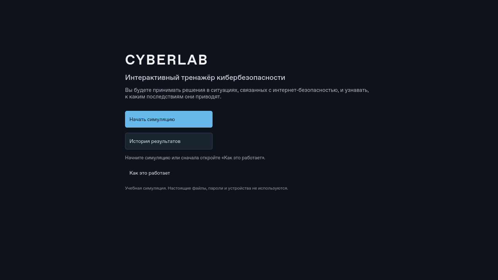
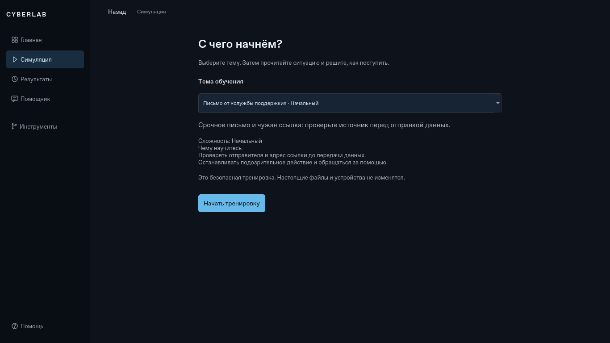
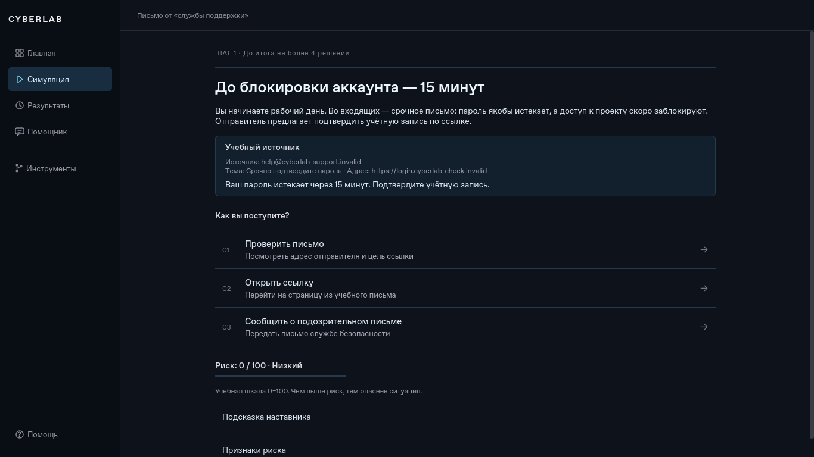
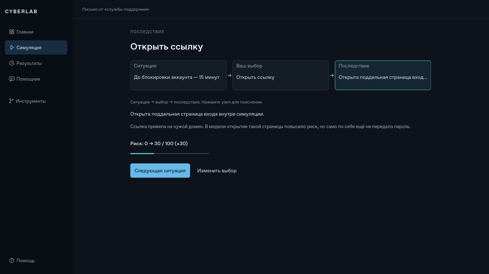
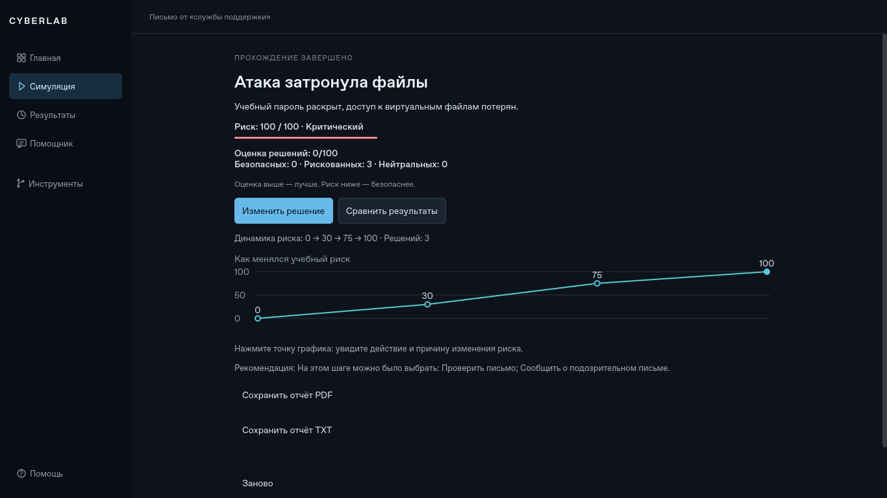
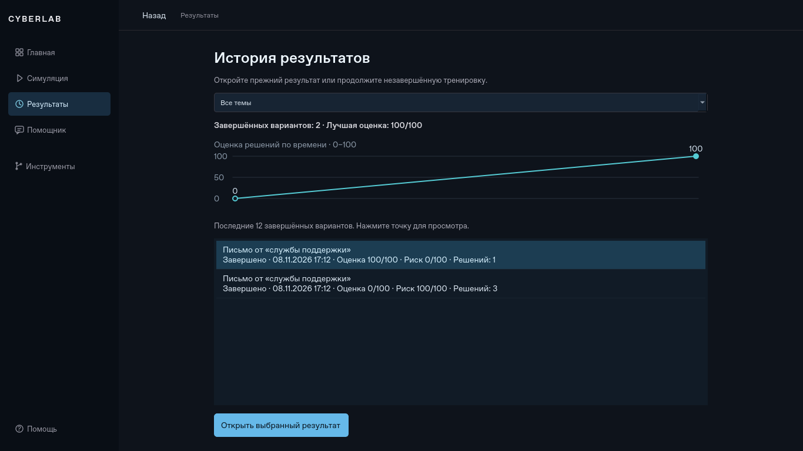
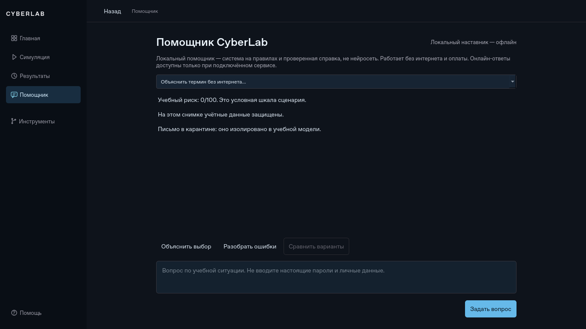

# CYBERLAB 2.0: изменения и проверка

Версия **2.0.0b1**, этап от **9 ноября 2026 года**. Это версия для проверки,
а не заявление о завершённой сертификации всех Windows/Linux-систем.

## С чего началась работа

В `main` был ранний прототип `bfef782` и обновлённая инструкция. Рабочие сборки,
четыре сценария и новый главный экран находились в `build/guided-learning-ux`.
За основу взята эта ветка `6e6d2be`, документация main сохранена отдельным merge.
Создана ветка `build/cyberlab-2`; код приложения в main автоматически не заменялся.

Проверены модель, сценарии, SQLite, логика прохождения, интерфейс, помощник,
отчёты, точка входа, упаковка и тесты. Перед изменениями прошли **156 тестов**.

Что уже работало и сохранено:

- Неизменяемые снимки, возврат к любому решению и альтернативные пути.
- Повтор выбора без дублирования, сравнение и восстановление после перезапуска.
- Учебные почта, файлы, браузер и журнал виртуального ПК.
- Локальные объяснения и необязательный API в QThread с тайм-аутом и fallback.
- SQLite v1, EXE/установщик, AppImage и рецепт RPM-кандидата.

## Что сделано

| Раздел | Результат |
| --- | --- |
| Главная | «Начать симуляцию», «Как это работает», «История результатов»; продолжение появляется при наличии тренировки |
| Вводный урок | Пять коротких экранов: фишинг, пути попадания программ, проверка адреса с пробным действием, макросы и прохождение; возвращает к выбранной теме |
| Каталог | Шесть тем со сложностью, описанием и учебными целями |
| Симуляция | Вымышленный источник прямо на экране, текущий шаг, верхняя граница оставшихся решений, выбор и объяснение |
| Последствия | Интерактивная схема «ситуация → выбор → последствие», изменение риска и понятное продолжение |
| Итоги | Оценка, счётчики решений, график риска с выбором точки, рекомендации и разбор ошибок |
| Помощник | Локальная справка и разбор сохранённого пути; честная подпись системы на правилах |
| История | Каждый завершённый вариант, включая старый после возврата к корню; фильтр темы и диаграмма оценок |
| Отчёт | TXT сохранён; добавлен настоящий PDF с кириллицей, переносами и несколькими страницами |
| Ошибки | Понятное сообщение; техническая причина раскрывается отдельно. Отмена экспорта не оставляет ложный статус успеха |
| Стиль | Графитовый фон, синий основной акцент и бирюзовые диаграммы; критический риск подписан и отмечен цветом |

### Сценарии

| Сценарий | Маршрутов | Особенность |
| --- | ---: | --- |
| Письмо от «службы поддержки» | 8 | Старые ID, переходы и значения риска сохранены |
| Вредоносное вложение | 8 | Открытие документа отличается от разрешения макросов |
| Поддельный сайт | 8 | HTTPS и знакомый вид не заменяют проверку адреса |
| USB | 7 | Извлечение накопителя не останавливает уже запущенную программу |
| Сообщение со ссылкой | 8 | Подтверждение через известный контакт и распространение обмана через чужой сеанс |
| Загрузка программы | 8 | Источник, загрузка, разрешение выполнения и реакция на активность |

Итого **47 завершённых маршрутов**. Все данные вымышлены. В коде сценариев
нет скачивания файлов, вызова программ, сетевых атак или настоящей рассылки.
Для загрузки в модель добавляется только текстовый учебный установщик;
возврат к предыдущему снимку убирает его из списка виртуального ПК.

### Риск и оценка — разные показатели

Риск задаётся переходами StateChange и не выбирается случайно:
0–25 — низкий, 26–50 — умеренный, 51–75 — высокий, 76–100 — критический.
Старые численные последствия не пересчитывались, изменены названия диапазонов.

`assessment.assess_path` берёт только предков выбранного результата.
Полезное решение даёт 2 балла, нейтральное 1, рискованное 0. Сумма делится
на максимум `2 × число решений`, умножается на 100 и округляется.
Без решений оценки нет. Ошибки определяются ростом риска или появлением утечки,
потери файлов либо активной программы. Полезными считаются снижение риска,
проверка источника и остановка угрозы. Правила общие для интерфейса и отчётов.

Например, «открыть ссылку → передать пароль → изолировать» содержит две ошибки
и одно полезное решение: оценка 33/100. Отключение сети уменьшит текущий риск,
но не отменит уже переданный пароль и не сотрёт прежние ошибки.
Это учебная оценка действий, не измерение реальной вероятности заражения
и не доказательство освоения темы учеником.

### История и совместимость

Новых SQL-таблиц не требуется. Решения, даты, последствия и риск уже сохранены
в SQLite; ошибки и оценка восстанавливаются из них одним алгоритмом.
Это исключает расхождение отдельной таблицы оценок с исходными решениями.
Версия схемы остаётся **1**. Старые JSON читаются с безопасными значениями
новых необязательных полей. Старые записи при открытии не переписываются.
Тест с опубликованной базой из 14 снимков и сравнением SQL-схемы сохранён.

История теперь показывает все завершённые варианты, а не только активный
указатель тренировки. Диаграмма использует последние 12 завершённых вариантов
по дате; незавершённые пути не смешиваются с итоговыми оценками.
Это сравнение вариантов, а не автоматическое доказательство прогресса ученика.

Обратный переход к старой программе, которая не знает новые сценарии и поля,
не поддерживается. Пользовательский каталог данных и название организации Qt
не изменились.

### Помощник и локальная нейросеть

Основной режим полностью локальный: `glossary.py` содержит тексты и ключевые
слова, `mentor.py` объясняет уже сохранённое состояние и последнее решение.
Неизвестный вопрос получает честное сообщение об ограничении справки.
Помощник не получает ссылку на сессию или соединение SQLite.

Возможность локальной нейросети рассмотрена. Для неё нужны отдельные веса,
дополнительная ОЗУ и проверка скорости и качества русского ответа на школьных ПК.
Даже квантование весов не устраняет память на контекст и среду выполнения.
Модель в сборку не включена: для этой учебной версии выбран проверяемый
справочник. Локальная модель не устанавливалась, её скорость и потребление памяти
здесь не измерялись.

Существующий custom-клиент допускает OpenAI-совместимый сервер на localhost.
Протокол проверен имитацией HTTP, реальный локальный LLM-сервер не запускался.
Необязательный DeepSeek сохранён; ключи только в окружении, вызовы только по кнопке,
контекст ограничен пройденными данными. Его ответы могут ошибаться.
Живой платный API в этом этапе не проверялся и для тренировки не нужен.

## Где искать код

| Файл | Назначение |
| --- | --- |
| `domain.py`, `session.py`, `storage.py` | Прежняя модель, управление текущим путём, транзакции SQLite |
| `message_scenario.py`, `download_scenario.py` | Две новые истории как обычные Python-объекты |
| `assessment.py` | Общий алгоритм оценки и рекомендаций по фактическим решениям |
| `statistics.py` | Читает все сохранённые результаты без изменения базы |
| `welcome_pages.py`, `tutorial.py` | Главная, каталог и вводное обучение |
| `simulation_pages.py`, `visuals.py` | Экраны прохождения, график и интерактивная схема Qt |
| `history_page.py` | Фильтр, список вариантов и диаграмма оценок |
| `glossary.py`, `mentor.py`, `ai_panel.py` | Локальная справка, объяснения и панель помощника |
| `reports.py`, `pdf_report.py` | Общий текст отчёта и преобразование в PDF средствами Qt |
| `ui_helpers.py`, `ui.py`, `app.py` | Элементы управления, маршрутизация и сообщения об ошибках |
| `diagnostics.py` | Запуск всех шести тем в готовой сборке без сетевых запросов |

## Проверка пути новичка

Путь воспроизведён в настоящем Qt через кнопки и события клавиатуры с временной
историей. Снимки просмотрены отдельно. Это самостоятельная проверка разработчика,
а не пользовательское исследование с учениками.

| Экран | Где я? | Что дальше? | Зачем? |
| --- | --- | --- | --- |
| Главная | Название и назначение | «Начать симуляцию» или вводный урок | Узнать последствия решений |
| Урок | Номер экрана из пяти | Пробное действие, далее или пропуск | Понять основные признаки обмана |
| Каталог | Выбранная тема и сложность | Начать тренировку | Видны учебные цели |
| Ситуация | Шаг и оставшиеся решения | Выбрать одно действие | Источник и варианты описаны |
| Последствие | Сделанный выбор и схема | Следующая ситуация или изменение выбора | Видны событие, причина и риск |
| Итог | Прохождение завершено | Изменить решение, сравнить, повторить, сохранить PDF | Проверить альтернативу и разобрать ошибки |
| История | Сохранённые варианты | Выбрать результат; можно через точку графика | Посмотреть прежние решения |
| Помощник | Локальный режим подписан | Выбрать термин или запросить разбор | Получить объяснение текущих данных |

Ранее сохранённые инструменты и компьютер не образуют тупик: кнопка «Назад»
возвращает к прежней странице, «Симуляция» — к активному шагу. Переходы не делают
запросов API и не создают решений. При ошибке сохранения ложное последствие
не показывается. При закрытии во время API-запроса окно ждёт завершения потока
асинхронно; прежние проверки этого поведения сохранены.

## Реальные снимки 1366×768















## Результаты проверки

Проверено в облачной Debian 13 x86_64: Python 3.12.14, PySide6/Qt 6.12.0.

| Проверка | Фактический результат |
| --- | --- |
| До изменения модели | 156 passed |
| После сценариев и общего расчёта оценки | 183 passed |
| Полный pytest с Qt offscreen | 192 passed |
| Полный pytest с Qt xcb/Xvfb | 192 passed |
| Ruff check и format --check | Успешно |
| Сборка sdist и wheel 2.0.0b1 | Успешно |
| Установка wheel в отдельное окружение без сети | Успешно, запуск вне исходников |
| Шесть сценариев, альтернативы, TXT/PDF, статистика и SQLite в установленном wheel | Успешно, сетевых запросов нет |
| PyInstaller на локальной Debian | Собрана папка `dist/frozen/CyberLab` |
| Запуск локального бинарного файла без Python/uv в PATH | `frozen: true`, все шесть сценариев и PDF, сеть не использовалась |
| Читаемость PDF | Кириллица извлечена через QPdfDocument; длинный отчёт имеет несколько страниц |
| Отмена и ошибка экспорта | Прежний файл и SQLite сохранены, ложного статуса успеха нет |
| Старая SQLite | 14 снимков и SQL-схема не меняются; старый выбор не дублируется |
| Размеры и масштаб | 1280×720, 1366×768, 853×480, 640×420; 125/150% в отдельных процессах |

Проверка готового бинарного файла:

```sh
uv run --locked python scripts/verify_desktop.py dist/frozen/CyberLab/CyberLab --report build/linux-smoke.json
```

Локальная сборка создана на glibc 2.41 и предназначена для этой проверки,
а не для распространения на старые Linux. Переносимая AppImage собирается
отдельно на Ubuntu 22.04 (glibc 2.35) в GitHub Actions.

Снимки воспроизводятся `uv run --locked python docs/capture_ui.py` в графической
сессии. Для Linux без дисплея можно использовать `QT_QPA_PLATFORM=offscreen`.
Скрипт проходит вводный урок, опасный путь, возврат, безопасный вариант и историю
реальными событиями Qt, сохраняя восемь снимков и [пример PDF](v2/example-report.pdf).

Первый удалённый [Checks 42502492881](https://github.com/kiollaif/cyberlab/actions/runs/42502492881)
на `57409e3` выявил выход ширины экрана ситуации при 640×420 на Windows.
Linux-тесты и офлайн-пакет прошли. Тест сохранён, добавлены диагностические размеры;
длинные подписи вспомогательных действий сокращены. Повторная Windows-проверка
учитывается отдельно после её фактического завершения.

## Оставшиеся ограничения

- Нужна проверка понятности с учениками без помощи автора.
- Физические Windows 10/11 и Альт Образование вручную здесь не запускались.
- Общий Desktop/Chrome недоступен: в выбранной среде `capabilities` пуст,
  инструмента `cua_repl.js` нет. Среда: `ccarenv_b64_Y2NhcmVudl84NzhmN2ZmZWJiYmM4MTkxYjM1NWRjZGNhMDc5ODEwYQ`.
  Доступны нативный Qt xcb/Xvfb, программные нажатия и реальные снимки окна.
- Локальная нейросеть и живой API не проверены; обязательных сетевых сервисов нет.
- Модель показывает отдельные учебные цепочки, а не полноценную ОС, эпидемиологию
  вредоносного ПО или проверку безопасности настоящего устройства.
- Поддержка конкретной системы ALT Education требует отдельного испытания;
  сборка в контейнере ALT p11 этого не подтверждает.
