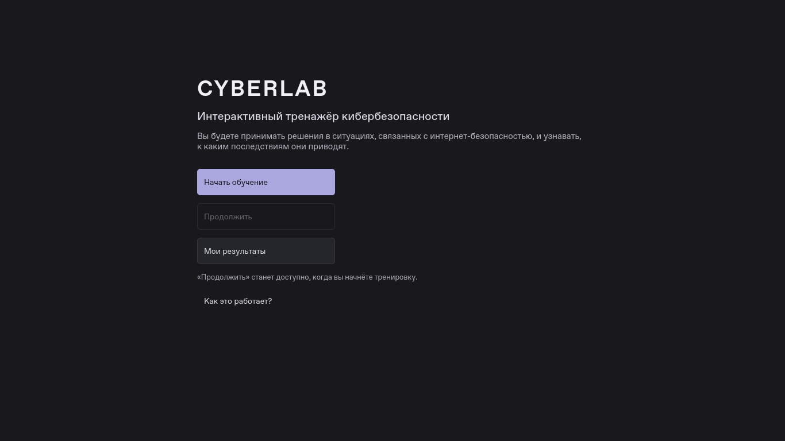
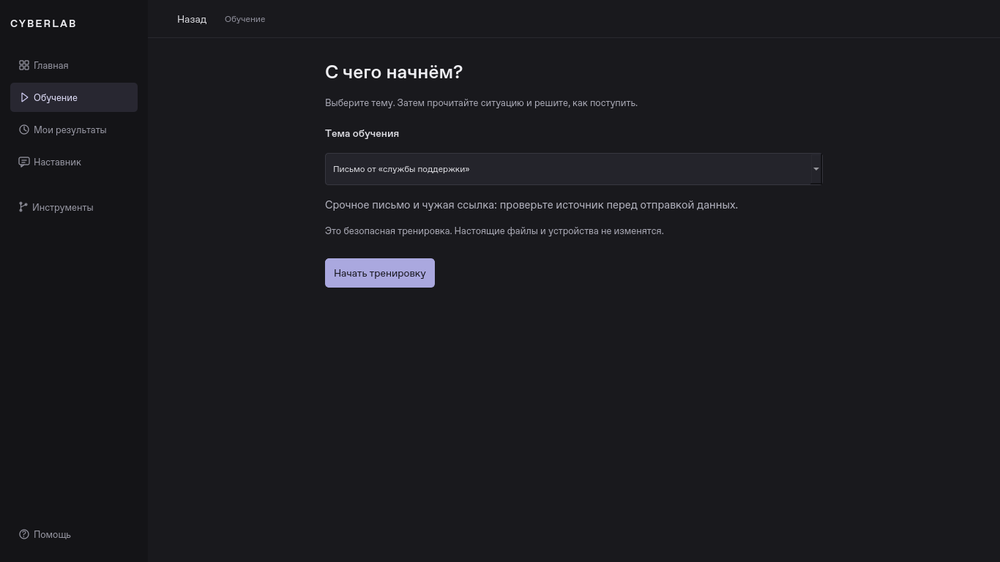
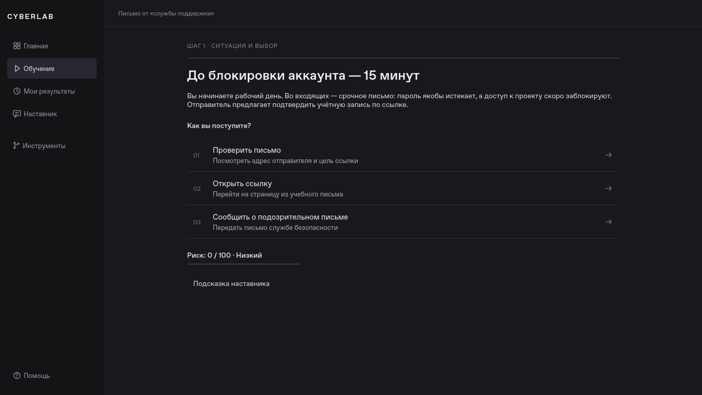
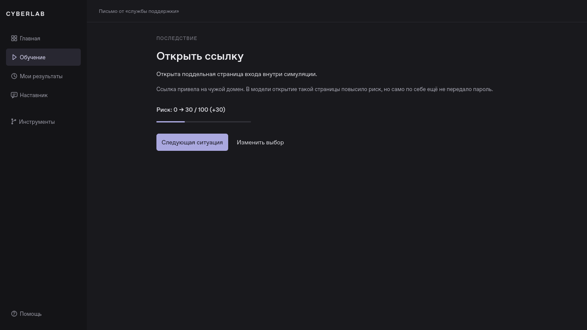
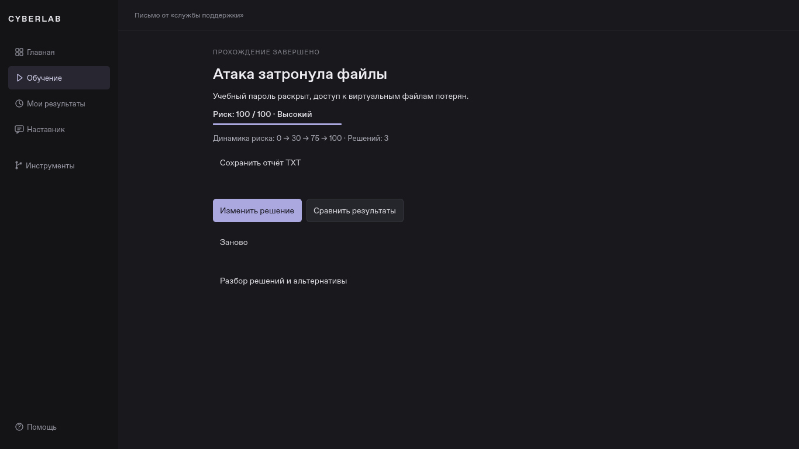
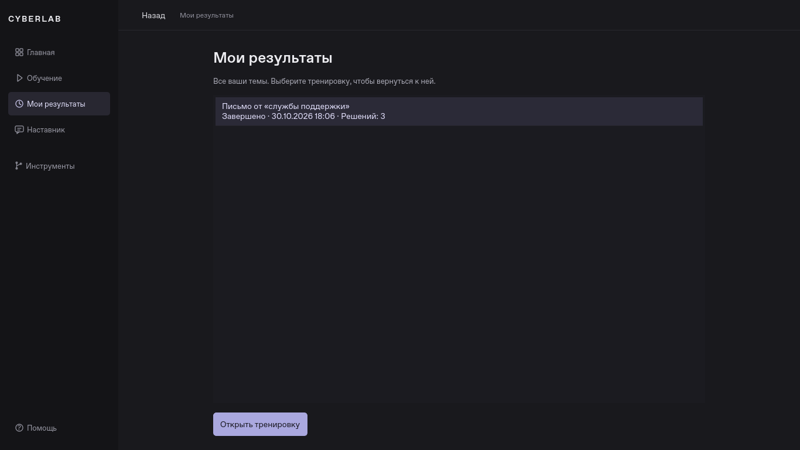

# Понятный первый запуск CYBERLAB

Этап от **31 октября 2026 года**, код `9514a4a` (основная перестройка — `5e0fd9a`).
PySide6 сохранён, новых зависимостей нет. Изменён маршрут пользователя,
а не только цвета. Сценарии, риск, снимки, локальный и онлайн-наставник работают
через прежние модули.

## Что мешало и что изменено

| Раньше | Теперь |
| --- | --- |
| Сразу список тем и восемь разделов; непонятно, с чего начать | Главная объясняет цель и показывает три основных действия |
| Первый запуск проходил через пять обязательных вводных экранов | Два нажатия до первой ситуации; знакомство открывается по желанию |
| История показывала только выбранный сценарий | «Мои результаты» показывают тренировки всех четырёх тем |
| Продолжение зависело от выбранной темы | «Продолжить» возвращает последнюю открытую тренировку, включая непрочитанное последствие |
| Инструменты конкурировали с текущим выбором | «Ваши решения», сравнение и компьютер раскрываются через «Инструменты» |
| Техническая статистика ответа появлялась автоматически | Она открывается через «Статистика ответа»; слово «токены» объяснено в подсказке |

## Главный экран

На главной нет боковой панели, технических идентификаторов, сводки компьютера
или списка сценариев. Пользователь видит:

- **CYBERLAB**.
- **Интерактивный тренажёр кибербезопасности**.
- «Вы будете принимать решения в ситуациях, связанных с интернет-безопасностью,
  и узнавать, к каким последствиям они приводят».
- **Начать обучение**, **Продолжить**, **Мои результаты**.
- Небольшую кнопку **Как это работает?**.

«Продолжить» всегда на месте. До первой тренировки кнопка недоступна;
под ней объяснено, когда она заработает. После начала тренировки видна её тема.
Если настройки Qt потерялись, приложение ищет сохранённую тренировку с решениями
в SQLite. Просмотр другой темы не подменяет цель продолжения.



## Один понятный следующий шаг

```text
Главная → Начать обучение → Выбор темы → Начать тренировку
                                            ↓
                                    Ситуация и выбор
                                            ↓
                              Последствие с объяснением
                                            ↓
                          Следующая ситуация или результат
```

Для первой темы достаточно двух нажатий. Выбор другой темы добавляет выбор
в обычном списке. На странице темы также можно продолжить её прежнюю тренировку.
Новое прохождение не удаляет старое.

На странице ситуации основное внимание — тексту и 2–3 вариантам действия.
Условный риск остаётся виден, перечень внутренних флагов состояния убран
с этого экрана. Подсказка наставника раскрывается по желанию.

После выбора видны действие, событие, объяснение и изменение риска.
Следующая кнопка подписана по назначению: «Следующая ситуация» либо
«Посмотреть результат». «Изменить выбор» возвращает к предыдущей ситуации.







## Результат и дополнительные возможности

Итог объясняет, что случилось, и показывает динамику риска. Основное действие —
«Изменить решение»: можно попробовать другой путь, сохранив прежний для сравнения.
Рядом доступно сравнение. Экспорт TXT, новая тренировка и подробный разбор сохранены.



«Мои результаты» содержат все темы: название, дату, статус и число решений.
Пустой экран не показывает пустую таблицу: он объясняет назначение раздела
и предлагает начать обучение. Выбранная тренировка открывается одной кнопкой.



Во время тренировки основные разделы — главная, обучение, мои результаты,
наставник. История решений, сравнение и учебный компьютер находятся в раскрываемой
группе «Инструменты». Помощь остаётся внизу. На узком окне сохранён режим значков
с русскими подсказками и доступными именами; это компромисс для небольшого экрана.
Если высоты недостаточно, боковая панель прокручивается: кнопки сохраняют размер
и не перекрываются. Это проверяется отдельно для раскрытых инструментов.

## Оформление и код

Графитовая тема, один спокойный лавандовый акцент, без анимаций, градиентов и эмодзи.
Основной текст 14 px, текст выбора 15 px, заголовок ситуации 26 px.
Обычные действия не ниже 40 логических пикселей, три главные кнопки — не ниже 46.
Русские тексты переносятся, длинные экраны прокручиваются.

| Файл | Ответственность |
| --- | --- |
| `welcome_pages.py` | Две простые страницы: главная и выбор темы |
| `ui.py` | Соединяет кнопки с переходами; продолжение и открытие результатов |
| `navigation.py` | Основные разделы и раскрываемые инструменты |
| `simulation_pages.py` | Ситуация, последствие и итог |
| `styles.py`, `ui_helpers.py` | Типографика, цвета, размеры, общие кнопки |
| `ai_panel.py` | Понятные подписи и раскрываемая статистика; прежний QThread |
| `tutorial.py` | Пять необязательных подсказок с безопасным пробным действием |
| `session.py`, `storage.py` | Чтение результатов всех тем без изменения схемы SQLite |

`HistoryRepository.sessions()` без фильтра читает все тренировки;
прежние вызовы с `scenario_id` продолжают работать. `open_session` принимает
необязательный сценарий, проверяет его шаг и лишь затем меняет текущую тренировку.
Старые строки и таблицы не переписываются, версия SQLite остаётся **v1**.

## Что реально проверено

В этой облачной Linux x86_64 выполнены:

| Проверка | Результат |
| --- | --- |
| Исходный pytest | 147 passed |
| Полный pytest после изменений, Qt offscreen | **156 passed** |
| Полный pytest с нативным Qt xcb через Xvfb | **156 passed** |
| Ruff check, format --check, git diff --check | Успешно |
| `uv build --offline` | Собраны sdist и wheel |
| Установка wheel в отдельное окружение из кэша, запуск вне исходников | Успешно |
| Офлайн-проверка установленного wheel | Четыре темы, возврат, сравнение, TXT, локальный наставник, повторное открытие SQLite |
| Размеры и масштаб | 1280×720, 1366×768, 853×480, 640×420; 125/150% в отдельных процессах Qt |
| Визуальная проверка | Просмотрены реальные снимки главной, темы, ситуации, последствия, итогов и истории 1366×768 |

Шесть новых тестов `test_guided_ux.py` проверяют первый запуск, отсутствие
обязательного обучения, продолжение после просмотра другой темы и перезапуска,
результаты всех тем, пустую историю, инструменты и безопасный отказ при неверной
теме сохранённой тренировки. Ещё три случая в `test_navigation.py` проверяют
отсутствие перекрытия пунктов навигации и достижимость каждого из них прокруткой.
Прежние проверки всех 31 маршрута, истории,
минимальных экранов, AI и отзывчивости Qt сохранены. Изменены только нажатия,
которые теперь проходят через новую страницу выбора темы.

Первая перестройка `5e0fd9a` также прошла
[Checks на Windows и Ubuntu](https://github.com/kiollaif/cyberlab/actions/runs/41103014075).
После исправления прокрутки `9514a4a` запущены новые
[Checks](https://github.com/kiollaif/cyberlab/actions/runs/41104157840) и
[Desktop builds](https://github.com/kiollaif/cyberlab/actions/runs/41104157926).
На момент записи они ожидают завершения; их успех здесь не заявлен.

## Границы проверки

Автоматические тесты подтверждают поведение, но не доказывают понятность для
новичка. Следующий шаг — дать ученику без подсказок запустить тренировку,
изменить решение и сравнить последствия, записав места затруднений.

Ручная проверка на физических Windows 10/11, Альт Образование, Wayland
и живой платный API в рамках этого этапа не выполнялись.
