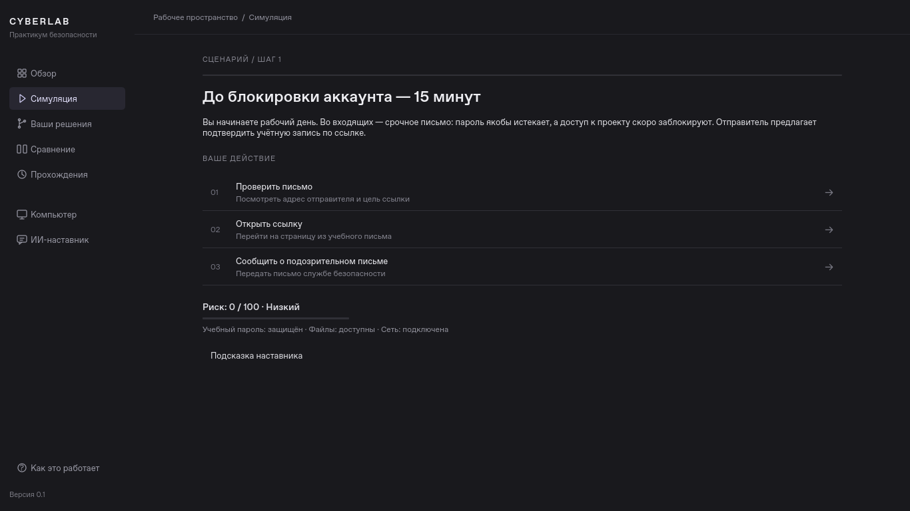
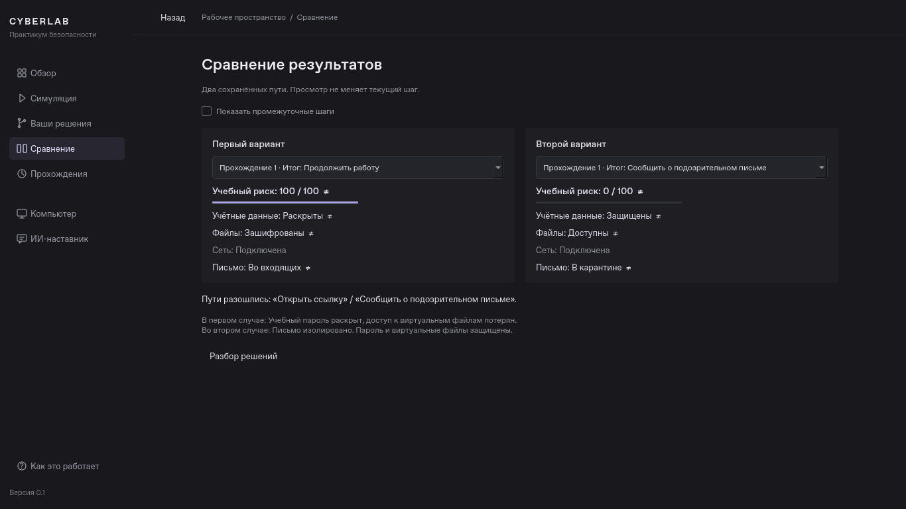
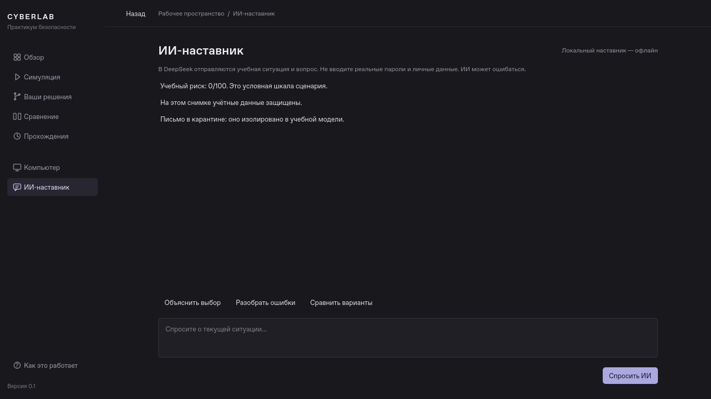

# Компактное рабочее пространство CYBERLAB

Переработка визуального интерфейса от 27 октября 2026 года. Основа — PySide6;
новых зависимостей нет. Сценарий, алгоритмы риска, SQLite, снимки, ветвление,
сравнение и клиент DeepSeek сохранены.

## Что изменилось

- Постоянная боковая навигация: обзор, симуляция, решения, сравнение, прохождения,
  компьютер и ИИ-наставник. Обучение доступно снизу панели.
- Обзор показывает один доступный сценарий и компактные действия начала/продолжения.
  История, инструменты и помощь не дублируются большими кнопками в содержимом.
- Варианты выбора — строки списка с номером, короткой подписью и пояснением.
- Последствие содержит действие, событие, причину и изменение риска. Повторяющиеся
  сводки и инструкции «нажмите кнопку» убраны.
- Результаты — небольшой итог и список решений с тонкими разделителями.
- Сравнение — два компактных столбца, знак ≠ у различающихся показателей и
  дополнительный разбор по запросу. На узком окне столбцы располагаются вертикально.
- ИИ-наставник оформлен как отдельный рабочий раздел: ответ, три коротких действия,
  поле вопроса и одна основная кнопка. Запросы по-прежнему отправляются только по нажатию.
- Виртуальный компьютер сохраняет все пять вкладок, файлы, письмо, журнал и уведомления.

Тема графитовая, один акцент — приглушённый лавандовый. Основной текст 13 px,
заголовки 24 px, кнопки обычно 32 px. Нет градиентов, свечений, эмодзи и толстых рамок.
Короткие действия используют штатный `QPushButton`: размер рассчитывает Qt по
шрифту и DPI. Проверки текста сохранены и дополнены проверкой минимального размера
нативных кнопок. Варианты выбора с описаниями используют строки с переносом.
Боковая панель имеет ширину 202 px; при ширине окна менее 980 px остаются значки
в полосе 60 px. Имена разделов сохраняются в русских подсказках и доступных именах.
Стандартные контекстные меню Qt также переведены на русский через `qtbase_ru`.

## Из каких файлов состоит интерфейс

| Файл | Назначение |
| --- | --- |
| `navigation.py` | Боковая панель; значки рисуются `QPainter`, без сторонних наборов |
| `ui.py` | Оболочка, обзор, маршрутизация в существующие обработчики |
| `ui_helpers.py` | Компактные кнопки, текстовые действия и строки выбора |
| `styles.py` | Цвета, размеры, состояния фокуса и выделение |
| `simulation_pages.py` | Ситуация, последствие, итог и короткая сводка риска |
| `review_pages.py` | Дерево решений и сравнение |
| `ai_panel.py` | Компоновка наставника; логика запросов и поток сохранены |
| `virtual_computer.py`, `tutorial.py` | Учебный ПК и короткое знакомство |
| `app.py` | Загрузка русского каталога стандартных переводов Qt |

Общие действия каждой страницы ссылаются на один виджет боковой панели.
Возврат к разделу «Симуляция» открывает текущий снимок, включая ещё не прочитанное
последствие, и не создаёт нового решения. Переход в ИИ не делает платный запрос.

## Реальные снимки 1366×768

Это снимки работающего Qt-приложения с временной учебной историей. Для каждого
из десяти экранов проверены размер окна и отсутствие горизонтального выхода
за viewport. При 1366×768 все основные экраны поместились без вертикальной прокрутки.
Длинные истории и ответы по-прежнему прокручиваются.

## Проверки

До изменений прошли 84 существующих теста. После перестройки прошли **88 тестов**:
все прежние и четыре новых случая навигации. Проверяются опасный/безопасный путь,
возврат, сравнение, старые SQLite v1 и перезапуск, ИИ без реальных платных запросов,
сохранение активного снимка при переходах, узкое окно и русский перевод меню Qt.

Локально выполнены оба режима: Qt `offscreen` и нативный `xcb` через Xvfb.
Также собраны sdist и wheel; wheel установлен в отдельный venv без сети и
прошёл запуск, опасный путь, возврат, безопасную ветку, сравнение и восстановление SQLite.
Ruff check, format --check и `git diff --check` выполнены.

Проверки точных размеров 1366×768 и 1280×720, а также 640×420 и масштабов
125/150% сохранены. Нативные тесты учитывают доступную рабочую область ОС.
В этой облачной среде визуально просмотрены снимки Linux. Реальные Windows 10/11
и ALT Образование вручную не запускались. Полная матрица GitHub Actions подтверждена: [запуск 40365742462](https://github.com/kiollaif/cyberlab/actions/runs/40365742462)
на коммите `c0a643a` завершился успешно на **Windows и Ubuntu**. В каждом задании
прошли запуск нативного Qt, 88 тестов, сборка и офлайн-проверка установленного пакета.
Это автоматическая проверка Windows runner, которая не заменяет ручную оценку
интерфейса на физических Windows 10/11.
